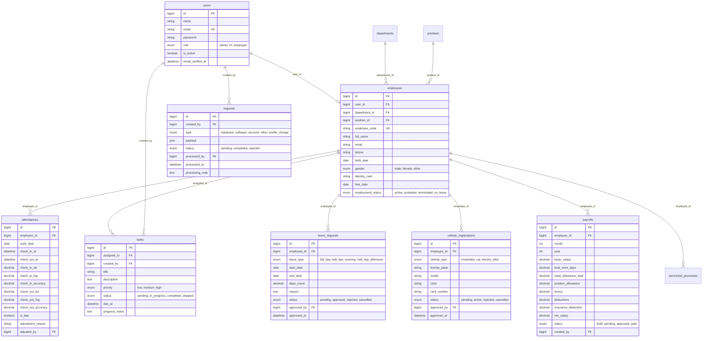

# Tài liệu Code & Logic Toàn Hệ Thống (HRMS System Architecture & Logic)

Tài liệu này tổng hợp toàn diện kiến trúc, luồng nghiệp vụ, phân quyền, cấu trúc cơ sở dữ liệu và mã nguồn triển khai của toàn bộ hệ thống Quản lý Nhân sự (**Laravel HRMS**) cho cả 3 vai trò: **Admin**, **HR (Quản trị Nhân sự)** và **Employee (Nhân viên)**.

---

## 1. Tổng quan Kiến trúc Hệ thống

### 1.1. Công nghệ & Nền tảng
- **Framework:** Laravel 11/13 (PHP 8.3+)
- **Kiến trúc:** Monolithic MVC + Service Layer
- **Giao diện:** Laravel Blade + TailwindCSS v4 + Heroicons / Lucide Icons
- **Database:** MySQL / MariaDB 8.4+ (sử dụng Eloquent ORM, Migrations, Seeders)
- **Xác thực & Bảo mật:** Session-based Authentication, Role Middleware, Active Account Middleware, Work-shift GPS Enforcement, Form Requests, Model Policies.

### 1.2. Sơ đồ Kiến trúc Tổng quát

```text
                                  +---------------------+
                                  |    Web Browser      |
                                  +----------+----------+
                                             | HTTP / HTTPS
                                             v
                             +---------------+---------------+
                             |       Laravel Router          |
                             +---------------+---------------+
                                             |
                         +-------------------+-------------------+
                         |                   |                   |
                         v                   v                   v
                   [Auth & Role]      [Active State]   [GPS Check-in Gate]
                   (Middleware)        (Middleware)       (Middleware)
                         |                   |                   |
                         +-------------------+-------------------+
                                             |
                                             v
                           +-----------------+-----------------+
                           |         Controllers / Form        |
                           |             Requests              |
                           +-----------------+-----------------+
                                             |
                         +-------------------+-------------------+
                         |                   |                   |
                         v                   v                   v
                   [Controllers]      [Service Layer]       [Blade Views]
                   - Admin/*          - AttendanceService   - admin/*
                   - Hr/*             - GpsLocationService  - hr/*
                   - Employee/*       - PayrollService      - employee/*
                         |                   |
                         +---------+---------+
                                   |
                                   v
                          +--------+--------+
                          |  Eloquent ORM   |
                          | (11 Data Models)|
                          +--------+--------+
                                   |
                                   v
                        +----------+----------+
                        |   MySQL Database    |
                        +---------------------+
```

---

## 2. Ma trận Phân quyền & Middleware Pipeline

### 2.1. Bảng phân quyền theo vai trò (Role Matrix)

| Chức năng / Phân hệ | Admin | HR (Quản trị nhân sự) | Employee (Nhân viên) |
| :--- | :---: | :---: | :---: |
| **Đăng nhập / Đăng xuất** |  |  |  |
| **Bắt buộc Check-in GPS hôm nay** | *Miễn trừ* |  *(Bắt buộc)* |  *(Bắt buộc)* |
| **Dashboard quản trị hệ thống** |  | ❌ | ❌ |
| **Dashboard Cổng nhân sự** | ❌ |  | ❌ |
| **Dashboard cá nhân** | ❌ | ❌ |  |
| **Quản lý Tài khoản & Phân quyền** |  | ❌ | ❌ |
| **Phê duyệt / Từ chối PYC (Requests)** |  *(Quyết định)* | 👁️ *(Theo dõi)* | ❌ *(Chỉ tạo của mình)* |
| **Quản lý Nhân viên (CRUD)** | ❌ |  | ❌ |
| **Quản lý Phòng ban & Chức vụ (CRUD)** | ❌ |  | ❌ |
| **Quản lý Chấm công toàn công ty** | ❌ |  *(Xem & Điều chỉnh)* | ❌ *(Chỉ xem cá nhân)* |
| **Giao việc (Tasks)** | ❌ |  *(Tạo, sửa, giao việc)*| ❌ *(Nhận & cập nhật)* |
| **Quản lý Đơn nghỉ phép** | ❌ |  *(Duyệt/Từ chối)* |  *(Tạo & hủy của mình)* |
| **Quản lý Đăng ký Gửi xe** | ❌ |  *(Cấp thẻ/Duyệt)* |  *(Tạo đơn gửi xe)* |
| **Tính & Chốt Bảng lương (Payroll)** | ❌ |  *(Tự động tính & Duyệt)* | 👁️ *(Xem phiếu cá nhân)* |
| **Quy trình Tuyển dụng & Thôi việc** | ❌ |  | ❌ |

---

### 2.2. Chi tiết các Middleware cốt lõi

1. **`auth` (`Authenticate`):**
   - Đảm bảo người dùng đã xác thực danh tính qua Session. Khách chưa đăng nhập sẽ bị điều hướng về `/login`.

2. **`active.user` (`EnsureActiveUser`):**
   - Kiểm tra cờ `is_active = true` trên bảng `users`.
   - Nếu tài khoản bị vô hiệu hóa: Đăng xuất ngay lập tức, hủy Session và trả về thông báo lỗi: *"Tài khoản của bạn đã bị khóa hoặc ngừng hoạt động."*

3. **`role:{roles}` (`RoleMiddleware`):**
   - Xác thực giá trị `user->role` thuộc danh sách cho phép (ví dụ: `role:admin`, `role:hr`, `role:employee`, hoặc `role:hr,employee`).
   - Nếu vi phạm: Trả về lỗi `403 Forbidden`.

4. **`employee.checked.in` (`EnsureEmployeeCheckedIn`):**
   - Áp dụng cho các route workspace của **HR** và **Employee** (Admin được miễn trừ).
   - Kiểm tra xem hôm nay nhân viên đã có bản ghi `attendances` với `check_in_at != null` hay chưa.
   - Nếu chưa check-in: Chặn truy cập các màn hình nghiệp vụ khác và điều hướng về Dashboard kèm popup/modal bắt buộc Check-in.
   - Ngoại lệ mở: Route Check-in, Check-out và Logout luôn được phép đi qua để tránh vòng lặp chuyển hướng vô tận.

---

## 3. Module Chấm công & Check-in / Check-out GPS (Attendance)

### 3.1. Luồng nghiệp vụ Check-in GPS

```text
[Người dùng đăng nhập]
        |
        v
[Có Attendance hôm nay & check_in_at != null?]
        |                               |
       Không                            Có
        |                               |
        v                               v
[Hiện Modal bắt buộc Check-in]    [Cho phép vào Workspace]
        |
        v
[Bấm "Xác nhận Check-in"]
        |
        +---> Trình duyệt lấy Tọa độ GPS (Lat, Lng, Accuracy)
        |
        v
[Gửi Request lên POST /attendance/check-in]
        |
        v
[GpsLocationService kiểm tra khoảng cách đến văn phòng]
        |
        +---> Nếu ngoài bán kính (GPS_RADIUS_METERS > 100m) -> Báo lỗi khoảng cách
        +---> Nếu độ lệch GPS > 1000m -> Báo lỗi tín hiệu GPS yếu
        |
        v
[Lưu bản ghi Attendance hôm nay]
        - work_date = today()
        - check_in_at = now()
        - check_in_lat, check_in_lng, check_in_accuracy
        - is_late = (giờ check-in > 08:30:00)
```

### 3.2. Luồng Check-out và Đăng xuất an toàn

- **Thao tác Check-out:** Là hành động thủ công, ghi nhận tọa độ GPS tại thời điểm rời văn phòng (`check_out_at`, `check_out_lat`, `check_out_lng`).
- **Bấm Đăng xuất khi ca làm việc chưa kết thúc:**
  - Nếu `check_out_at == null`: Hệ thống **không** cho đăng xuất ngay, mà hiển thị Modal/Màn hình xác nhận Check-out để nhắc nhở nhân viên hoàn thành ca.
  - Sau khi Check-out thành công hoặc xác nhận, hệ thống mới tiến hành hủy Session đăng nhập.
- **Quy tắc bất biến:**
  - Mỗi nhân viên chỉ có **duy nhất 1 bản ghi** chấm công trong ngày (`UNIQUE(employee_id, work_date)`).
  - Không thể Check-out nếu chưa Check-in.
  - Không thể Check-out lần 2 (nút chuyển sang `Đã Check-out` và bị disabled).

### 3.3. File mã nguồn chính
- **Controller:** `app/Http/Controllers/AttendanceController.php`, `app/Http/Controllers/AttendanceManagementController.php`
- **Service:** `app/Services/AttendanceService.php`, `app/Services/GpsLocationService.php`
- **Views:** `resources/views/attendance/*`, modal tích hợp trong `employee/dashboard.blade.php` và `hr/dashboard.blade.php`.

---

## 4. Phân hệ Dành cho Employee (Cổng Nhân viên)

Nhân viên là nhân tố trung tâm, được cấp quyền thao tác trên dữ liệu của chính mình:

```text
                                +-------------------+
                                |  Employee Portal  |
                                +---------+---------+
                                          |
         +----------------+---------------+---------------+----------------+
         |                |               |               |                |
         v                v               v               v                v
   [Dashboard]       [Công việc]     [Nghỉ phép]      [Gửi xe]        [Bảng lương]
   - Thống kê ngày  - Nhận việc     - Tạo đơn nghỉ  - Đăng ký biển  - Xem phiếu lương
   - Giờ công       - Cập nhật tiến - Theo dõi duyệt - Nhận thẻ bãi  - Thu nhập năm
   - PYC gần đây      độ, ghi chú   - Hủy đơn chờ   - Hủy đăng ký   - Chi tiết khấu trừ
```

### 4.1. Dashboard Cá nhân (`RoleHomeController::employee`)
- **Dữ liệu thời gian thực:**
  - Trạng thái chấm công hôm nay, giờ vào, giờ ra, cảnh báo đi trễ.
  - Tổng số công việc được giao, số việc đến hạn hôm nay.
  - Danh sách 5 công việc mới nhất kèm thanh tiến độ.
  - Danh sách 5 Phiếu yêu cầu (PYC) mới nhất và trạng thái xử lý.
  - Thông tin chức vụ, phòng ban, mã nhân viên.

### 4.2. Quản lý Công việc Cá nhân (`EmployeeTaskController`)
- **Phân quyền chặt chẽ:** Chỉ xem và cập nhật task được gán cho chính mình (`assigned_to === user->employee->id`). Mọi hành vi cố tình xem task người khác đều trả về `403`.
- **Trạng thái hỗ trợ:** `pending`, `in_progress`, `completed`, `stopped`.
- **Thao tác:** Cập nhật trạng thái thực thi và ghi chú kết quả công việc.

### 4.3. Quản lý Đơn Nghỉ phép (`EmployeeLeaveController`)
- **Loại nghỉ phép:** Nghỉ cả ngày (`full_day`), Nghỉ nửa ngày sáng (`half_day_morning`), Nghỉ nửa ngày chiều (`half_day_afternoon`).
- **Tính toán:** Tự động tính số ngày nghỉ (`days_count`), gửi kèm lý do và file minh chứng (nếu có).
- **Hủy đơn:** Nhân viên có quyền hủy đơn xin nghỉ phép khi đơn còn ở trạng thái `pending`.

### 4.4. Đăng ký Phương tiện & Thẻ gửi xe (`EmployeeParkingController`)
- **Loại phương tiện:** Xe máy (`motorbike`), Ô tô (`car`), Xe điện (`electric_bike`).
- **Trường dữ liệu:** Biển số xe, dòng xe / nhãn hiệu, màu xe.
- **Trạng thái:** Bắt đầu là `pending`, khi HR duyệt sẽ được gán `card_number` và chuyển sang `active`.

### 4.5. Tra cứu Lương & Phúc lợi (`EmployeePayrollController`)
- Xem danh sách bảng lương qua các tháng/năm.
- Xem chi tiết từng phiếu lương: Lương cơ bản, số ngày công thực tế, phụ cấp chức vụ, phụ cấp ăn trưa, thưởng, bảo hiểm bắt buộc và lương thực lĩnh (`net_salary`).

### 4.6. Hồ sơ & Yêu cầu Đổi thông tin (`EmployeeProfileController`)
- **Cập nhật trực tiếp:** Số điện thoại (`phone`), Email cá nhân (`email`), Địa chỉ cư trú (`address`), Ảnh đại diện (`avatar`).
- **Thay đổi thông tin pháp lý/nhạy cảm:** Ngày sinh, Giới tính, Số CCCD **không** cho sửa trực tiếp, mà phải tạo PYC loại `profile_change` chuyển Admin phê duyệt.

---

## 5. Phân hệ Dành cho HR (Cổng Quản trị Nhân sự)

HR chịu trách nhiệm toàn bộ vòng đời nhân sự và vận hành nội bộ:

```text
                                  +-------------------+
                                  |     HR Portal     |
                                  +---------+---------+
                                            |
         +-----------------+----------------+----------------+-----------------+
         |                 |                |                |                 |
         v                 v                v                v                 v
   [Hồ sơ Nhân sự]   [Cơ cấu Tổ chức]  [Quản lý Công]   [Vận hành Lương]   [Quy trình HR]
   - CRUD Nhân viên  - Phòng ban       - Giám sát vào/ra- Tự động tính lương- Tuyển dụng
   - Tự tạo User login- Chức vụ & hệ số- Chỉnh sửa công  - Chốt & thanh toán- Thôi việc / Offboarding
   - Trạng thái làm  - Chặn xóa khi     có lý do         - Thống kê chi phí- Giao việc (Tasks)
     việc              có ràng buộc    - Thống kê trễ   - Xuất bảng công   - Duyệt Phép / Xe
```

### 5.1. Quản lý Nhân sự & Tạo Tài khoản (`HrEmployeeController`)
- Thêm mới nhân viên thực hiện trong `DB::transaction`:
  1. Tạo bản ghi `User` (role `employee`, tạo mật khẩu mã hóa `Hash::make`).
  2. Tạo bản ghi `Employee` gắn với `user_id`, `department_id`, `position_id`, `employee_code` độc nhất.
- Cập nhật hồ sơ nhân sự, chuyển trạng thái: `active`, `probation`, `terminated`, `on_leave`.

### 5.2. Quản lý Cơ cấu Tổ chức (`HrDepartmentController`, `HrPositionController`)
- **Phòng ban:** Quản lý mã, tên, mô tả. Kiểm tra toàn vẹn: Không cho xóa phòng ban nếu vẫn còn nhân viên đang trực thuộc (`abort_if(employees()->exists(), 422)`).
- **Chức vụ:** Quản lý mã, tên, phụ cấp chức vụ mặc định.

### 5.3. Giám sát & Điều chỉnh Chấm công (`AttendanceManagementController`)
- Xem bảng chấm công toàn công ty theo ngày/tháng/phòng ban.
- Thống kê tỷ lệ đi làm, đi trễ (> 08:30:00), chưa check-out.
- **Quyền điều chỉnh:** HR được phép sửa đổi giờ check-in / check-out của nhân viên nhưng **bắt buộc** phải nhập lý do điều chỉnh (`adjustment_reason`) và hệ thống tự động ghi nhận ID của HR thực hiện (`adjusted_by`).

### 5.4. Tính toán & Quản lý Bảng lương (`HrPayrollController` & `PayrollCalculationService`)
- **Công thức tính lương tự động:**
  ```text
  Lương thực tế = (Lương cơ bản / Ngày công tiêu chuẩn 22) * Ngày công thực tế
  Phụ cấp cơm   = Mức phụ cấp ngày * Ngày công thực tế
  Tổng thu nhập = Lương thực tế + Phụ cấp chức vụ + Phụ cấp cơm + Thưởng
  Khấu trừ      = BHXH + BHYT + BHTN (theo quy định) + Phạt đi trễ
  Thực lĩnh     = Tổng thu nhập - Khấu trừ
  ```
- HR có thể bấm tính lương tự động cho cả tháng, xem xét chi tiết từng nhân viên, sửa đổi bổ sung thưởng/phạt và chốt bảng lương (`approved` / `paid`).

### 5.5. Phê duyệt Nghỉ phép & Đăng ký Xe (`HrLeaveController`, `HrParkingController`)
- Duyệt / Từ chối đơn xin nghỉ phép của nhân viên (kèm ghi chú).
- Cấp số thẻ gửi xe (`card_number`) và kích hoạt thẻ xe cho nhân viên mới đăng ký.

### 5.6. Quy trình Tuyển dụng & Thôi việc (`HrPersonnelProcessController`)
- **Tuyển dụng (`recruitment`):** Tạo đợt tuyển dụng, theo dõi số lượng hồ sơ, các vòng phỏng vấn, trạng thái (`draft` -> `in_progress` -> `completed`).
- **Thôi việc (`termination`):** Ghi nhận nhân viên thôi việc, ngày bàn giao, ngày kết thúc hợp đồng. Khi hoàn tất, tự động đổi trạng thái nhân sự sang `terminated` và vô hiệu hóa tài khoản đăng nhập `is_active = false`.

---

## 6. Phân hệ Dành cho Admin (Quản trị Hệ thống)

Admin nắm quyền cao nhất về bảo mật tài khoản và quyết định các Phiếu Yêu Cầu (PYC):

```text
                                  +-------------------+
                                  |   Admin Portal    |
                                  +---------+---------+
                                            |
                         +------------------+------------------+
                         |                                     |
                         v                                     v
             [Quản lý Tài khoản & Quyền]             [Phê duyệt Phiếu Yêu Cầu]
             - Xem danh sách toàn hệ thống           - Tiếp nhận PYC toàn công ty
             - Tạo tài khoản Admin, HR, Employee     - Duyệt PYC Phần cứng, Phần mềm
             - Kích hoạt / Khóa tài khoản tức thì     - Duyệt PYC Thay đổi Hồ sơ nhân sự
             - Đổi mật khẩu, phân bổ lại vai trò     - Ghi nhận lịch sử duyệt bất biến
```

### 6.1. Quản lý Tài khoản Người dùng (`AdminAccountController`)
- Danh sách phân trang toàn bộ User hệ thống.
- Tìm kiếm theo tên, email, lọc theo vai trò (`admin`, `hr`, `employee`) và trạng thái (`active`, `inactive`).
- Bật/tắt trạng thái hoạt động: Khóa tài khoản sẽ chặn đăng nhập và đẩy người dùng ra khỏi hệ thống ngay trong request tiếp theo nhờ middleware `active.user`.

### 6.2. Xử lý Phiếu Yêu Cầu / PYC (`AdminRequestController`)
- Xem danh sách và chi tiết các yêu cầu do nhân viên gửi lên.
- **Quy trình duyệt hồ sơ pháp lý:**
  - Với PYC loại `profile_change`: Khi Admin bấm Duyệt (`completed`), hệ thống áp dụng dữ liệu mới (CCCD, ngày sinh, giới tính) vào bảng `employees`.
  - Nếu Từ chối (`rejected`): Phải kèm lý do từ chối. Hồ sơ nhân viên cũ được giữ nguyên vẹn.
- **Nguyên tắc bất biến:** PYC đã qua xử lý (`completed` hoặc `rejected`) thì vĩnh viễn không thể xử lý lại hoặc bị ghi đè.

---

## 7. Cấu trúc Cơ sở Dữ liệu & Mối quan hệ (Database Schema)

Hệ thống bao gồm **11 thực thể Eloquent Models**:



---

## 8. Danh mục Routes & Endpoints Toàn Hệ thống

### 8.1. Tuyến Xác thực & Điều hướng Chung (`/`)
- `GET  /` -> `HomeController`: Chuyển hướng theo vai trò (Admin -> `/admin`, HR -> `/hr`, Employee -> `/employee`).
- `GET  /login` -> `Auth\LoginController@create`: Màn hình đăng nhập.
- `POST /login` -> `Auth\LoginController@store`: Xử lý đăng nhập.
- `POST /logout` -> `Auth\LogoutController`: Xử lý đăng xuất (kèm kiểm tra check-out ca làm việc).

### 8.2. Tuyến Chấm công Chung (`/attendance`)
- `GET  /attendance/check-in` -> `AttendanceController@create`: Giao diện check-in GPS.
- `POST /attendance/check-in` -> `AttendanceController@store`: Nhận tọa độ & ghi nhận check-in.
- `GET  /attendance/check-out` -> `AttendanceController@checkoutConfirmation`: Màn hình xác nhận check-out trước khi logout.
- `POST /attendance/check-out` -> `AttendanceController@checkout`: Ghi nhận check-out.
- `POST /attendance/reset-today` -> `AttendanceController@resetToday`: Reset dữ liệu công hôm nay (Dev/Testing).

### 8.3. Tuyến Cổng Quản trị (`/admin`)
- `GET   /admin` & `/admin/dashboard` -> `RoleHomeController@admin`: Dashboard Admin.
- `GET   /admin/accounts` -> `AdminAccountController@index`: Quản lý tài khoản.
- `POST  /admin/accounts` -> `AdminAccountController@store`: Tạo tài khoản mới.
- `PATCH /admin/accounts/{user}` -> `AdminAccountController@update`: Khóa/mở hoặc cập nhật tài khoản.
- `GET   /admin/profile` -> `AdminProfileController@show`: Xem hồ sơ Admin.
- `PATCH /admin/profile` -> `AdminProfileController@update`: Đổi thông tin Admin.
- `GET   /admin/requests` -> `AdminRequestController@index`: Danh sách toàn bộ PYC.
- `GET   /admin/requests/{requestModel}` -> `AdminRequestController@show`: Chi tiết PYC.
- `PUT   /admin/requests/{requestModel}` -> `AdminRequestController@process`: Duyệt/Từ chối PYC.

### 8.4. Tuyến Cổng Nhân sự (`/hr`)
- `GET    /hr` & `/hr/dashboard` -> `HrManagementController@dashboard`: Dashboard HR.
- **Nhân viên:**
  - `GET   /hr/employees` -> `HrManagementController@employees`: Danh sách nhân viên.
  - `GET   /hr/employees/create` -> `HrEmployeeController@create`: Form thêm nhân viên.
  - `POST  /hr/employees` -> `HrEmployeeController@store`: Lưu nhân viên & tài khoản.
  - `GET   /hr/employees/{employee}` -> `HrEmployeeController@show`: Chi tiết nhân viên.
  - `GET   /hr/employees/{employee}/edit` -> `HrEmployeeController@edit`: Sửa nhân viên.
  - `PATCH /hr/employees/{employee}` -> `HrEmployeeController@update`: Cập nhật nhân viên.
- **Phòng ban:**
  - `GET    /hr/departments` -> Danh sách phòng ban.
  - `POST   /hr/departments` -> Tạo phòng ban.
  - `PATCH  /hr/departments/{department}` -> Sửa phòng ban.
  - `DELETE /hr/departments/{department}` -> Xóa phòng ban (ràng buộc 0 nhân viên).
- **Chức vụ:**
  - `GET    /hr/positions` -> Danh sách chức vụ.
  - `POST   /hr/positions` -> Tạo chức vụ.
  - `PATCH  /hr/positions/{position}` -> Sửa chức vụ.
  - `DELETE /hr/positions/{position}` -> Xóa chức vụ.
- **Chấm công:**
  - `GET         /hr/attendance` -> Bảng chấm công công ty.
  - `GET         /hr/attendance/{attendance}` -> Chi tiết bản ghi chấm công.
  - `PUT / PATCH /hr/attendance/{attendance}` -> Điều chỉnh chấm công (ghi rõ lý do).
- **Công việc (Tasks):**
  - `GET    /hr/tasks` -> Bảng theo dõi công việc toàn công ty.
  - `POST   /hr/tasks` -> Giao task mới cho nhân viên.
  - `PATCH  /hr/tasks/{task}` -> Cập nhật thông tin task.
  - `DELETE /hr/tasks/{task}` -> Xóa task.
- **Đơn nghỉ phép & Gửi xe:**
  - `GET   /hr/leaves` & `PATCH /hr/leaves/{leave}`: Quản lý & phê duyệt nghỉ phép.
  - `GET   /hr/parking` & `PATCH /hr/parking/{vehicle}`: Quản lý & cấp thẻ xe.
- **Bảng lương (Payroll):**
  - `GET   /hr/payroll`: Danh sách bảng lương tháng.
  - `POST  /hr/payroll/generate`: Tự động tính toán bảng lương cả công ty theo tháng/năm.
  - `PATCH /hr/payroll/{payroll}`: Duyệt hoặc chốt bảng lương.
- **Quy trình Tuyển dụng / Thôi việc:**
  - `GET   /hr/recruitment`, `POST /hr/recruitment`: Tuyển dụng.
  - `GET   /hr/termination`, `POST /hr/termination`: Thôi việc.
  - `PATCH /hr/processes/{process}`: Cập nhật tiến độ quy trình.

### 8.5. Tuyến Cổng Nhân viên (`/employee`)
- `GET    /employee` -> `RoleHomeController@employee`: Dashboard cá nhân.
- `GET    /employee/tasks` -> `EmployeeTaskController@index`: Task của tôi.
- `PUT    /employee/tasks/{task}/status` -> Cập nhật trạng thái & ghi chú task.
- `GET    /employee/profile` & `PUT /employee/profile`: Xem & cập nhật thông tin liên hệ.
- `POST   /employee/profile/change-request`: Tạo PYC đổi thông tin pháp lý nhạy cảm.
- `GET    /employee/requests`: Danh sách PYC của tôi (CRUD khi pending).
- `GET    /employee/leaves`: Quản lý & tạo đơn xin nghỉ phép.
- `GET    /employee/parking`: Quản lý & tạo đơn đăng ký xe.
- `GET    /employee/payroll`: Bảng lương cá nhân & tra cứu thu nhập.

---

## 9. Danh sách Tài khoản Kiểm thử Hệ thống

Mật khẩu dùng chung cho tất cả các tài khoản demo: `10giokem7`

1. **Quản trị viên (Admin):**
   - Email: `admin@example.test`
   - Truy cập: `/admin/dashboard`
2. **Quản trị Nhân sự (HR):**
   - Email: `hr@example.test`
   - Truy cập: `/hr/dashboard`
3. **Nhân viên 1 (Employee):**
   - Email: `employee@example.test`
   - Mã nhân viên: `NV001`
   - Truy cập: `/employee`
4. **Nhân viên 2 (Employee 2):**
   - Email: `employee2@example.test`
   - Mã nhân viên: `NV002`
   - Truy cập: `/employee`
